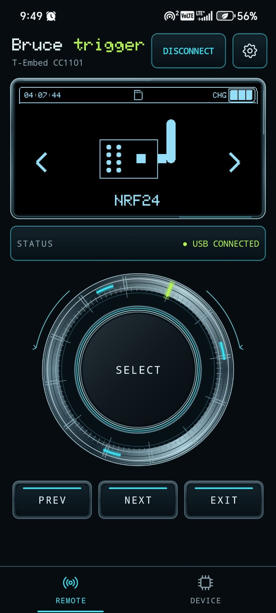
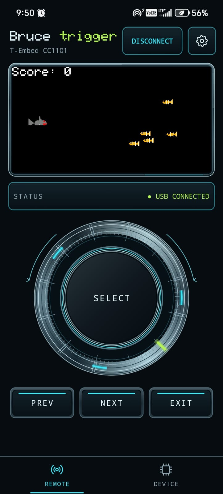
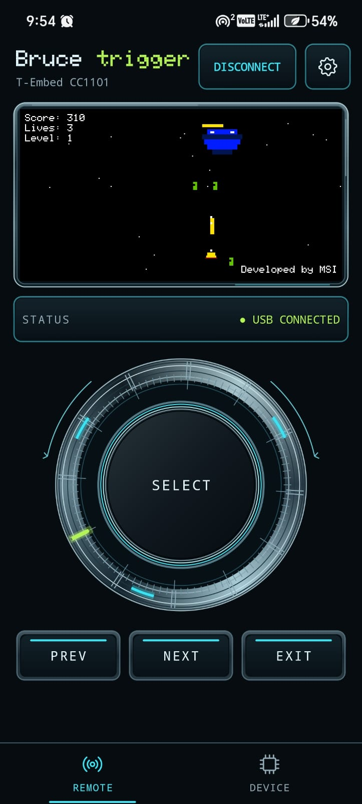

# Bruce Trigger

Control Bruce from your Android phone over USB.

Bruce Trigger is an Android companion app for the **LILYGO T-Embed CC1101**. Inspired by [Bruce firmware](https://bruce.computer/), it brings menu navigation, screen mirroring and supported games to your phone.

[**Download 1.0**](https://github.com/TabGrinder/bruce-trigger/releases/tag/v1.0) · [User guide](docs/USAGE.md) · [Screenshots](docs/SCREENSHOTS.md) · [Credits](CREDITS.md)

## Features

- Navigate Bruce with a rotary control and on-screen buttons.
- View supported menus and graphics on your phone.
- Use custom themes.
- Run supported JavaScript games from Bruce's Files menu.
- Play the included Megalodon adaptation.

## Requirements

- Android **8.0 or later** with USB host / OTG support.
- A **LILYGO T-Embed CC1101** running **Bruce 1.16.1**.
- A USB data cable and an OTG adapter if your phone needs one.

## Getting started

1. Download and install **Bruce-trigger-1.0.apk** from the [release page](https://github.com/TabGrinder/bruce-trigger/releases/tag/v1.0).
2. Start Bruce on the LILYGO and connect it to your phone with a USB data cable.
3. Open Bruce Trigger, tap **CONNECT** and allow USB access.
4. Turn the on-screen ring to browse and tap its center to select. Use **EXIT** to go back.

See the [user guide](docs/USAGE.md) for all controls and troubleshooting.

## Screenshots

| Bruce menu | Megalodon | Space Shooter |
| --- | --- | --- |
|  |  |  |

[View all screenshots](docs/SCREENSHOTS.md).

## Known limitations

Bruce Trigger works with custom themes, but the default theme provides smoother performance.

Screen mirroring supports a limited set of graphics operations, so some games and screens may appear incomplete. Animated GIF themes show a still preview. Keep the app open while using it; switching to another app closes the USB connection.

[Read all known limitations](docs/KNOWN_LIMITATIONS.md).

## Credits

Developed by **[TabGrinder](https://github.com/TabGrinder)**, with thanks to the **Bruce firmware team** and **LILYGO** for the firmware and hardware that inspired this project.

Megalodon is based on the game by **IncursioHack**. The display font comes from **Adafruit Industries**, via **TFT_eSPI by Bodmer**. See the [full credits](CREDITS.md) for all contributors and references.

Bruce Trigger is an independent community project and is not affiliated with BruceDevices or LILYGO.

## Use disclaimer

For educational purposes only. Use only on systems you own or are explicitly authorized to assess. Read the [full disclaimer](DISCLAIMER.md).

## License and development

The combined distribution is licensed under [GNU AGPLv3](LICENSE). The original Android companion's [MIT notice](LICENSE-MIT.txt) and all [third-party notices](NOTICE.md) are retained.

To build or contribute, see [Building from source](docs/BUILDING.md) and [Contributing](CONTRIBUTING.md). Test results and outstanding checks are listed in [Validation](VALIDATION.md).

Found a problem? [Open a bug report](https://github.com/TabGrinder/bruce-trigger/issues/new?template=bug_report.yml). For security issues, follow the [security policy](SECURITY.md).
