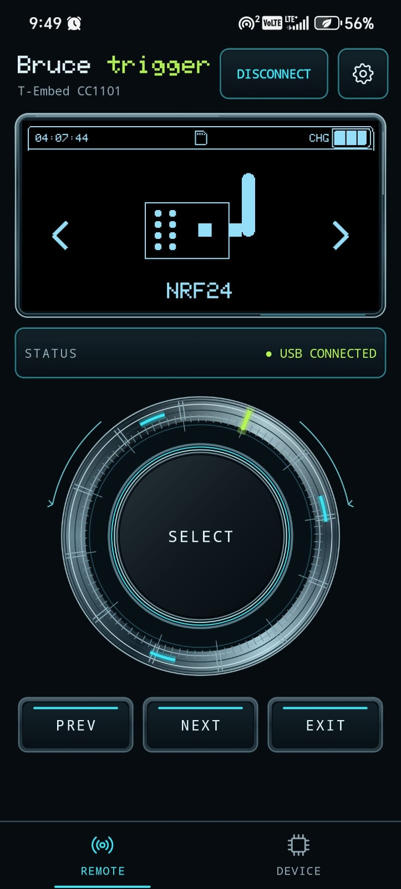
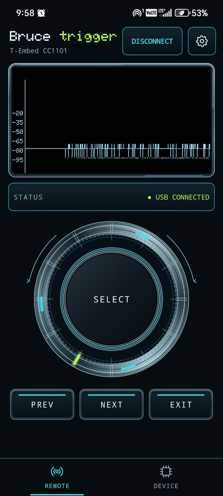
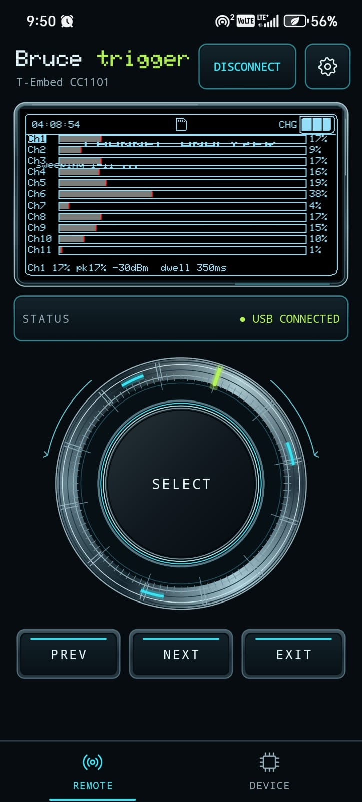

# Screenshots

Bruce Trigger's Remote screen, with examples of menus, games and graphs. Appearance varies with the firmware, theme and content.

## Menus and games

| Bruce menu | Megalodon | Space Shooter |
| --- | --- | --- |
|  |  |  |
| Menu navigation. | Megalodon by IncursioHack. | Space Shooter by MSI. |

## Graphs

| Signal graph | Channel activity | Frequency display |
| --- | --- | --- |
|  |  |  |
| Mirrored signal graph. | Channel activity; some labels overlap in this example. | Frequency labels and graph. |

Some graphics may render differently from the physical screen. See [Known limitations](KNOWN_LIMITATIONS.md).

The firmware, games and depicted assets belong to their respective authors. See [Credits](../CREDITS.md) for acknowledgements.
