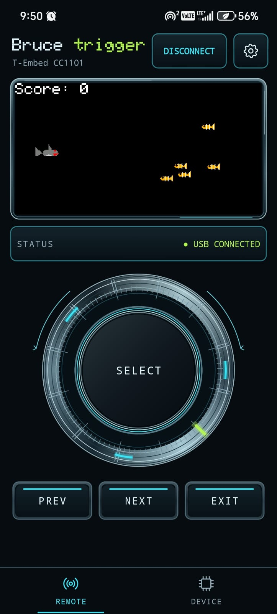
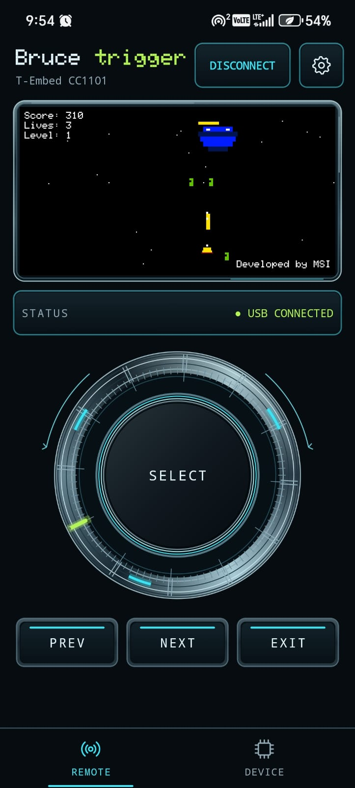
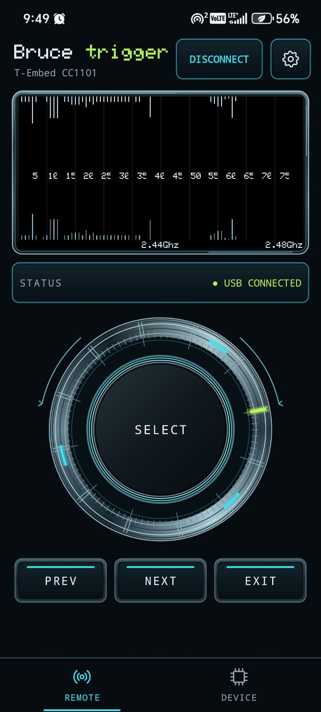

# Screenshots

These project-provided screenshots show Bruce Trigger's Remote interface and examples of mirrored content. They are preserved as supplied. Appearance depends on the firmware, active theme and content being displayed.

## Menus and games

| Bruce menu | Megalodon | Space Shooter |
| --- | --- | --- |
|  |  |  |
| Remote navigation with a Bruce menu. | Megalodon content above the navigation controls. | Space Shooter content, including the original on-screen author credit. |

## Graph and channel displays

| Signal graph | Channel activity | Frequency display |
| --- | --- | --- |
|  |  |  |
| Example of a mirrored line graph. | Example of channel labels and activity values; some text overlaps in this capture. | Example of frequency labels and graph content. |

These captions describe visible content only. They do not establish the underlying radio mode, measurement accuracy or compatibility with every firmware feature. The app mirrors supported drawing operations; see [Known limitations](KNOWN_LIMITATIONS.md).

## Attribution and validation

The Android companion is by **[TabGrinder](https://github.com/TabGrinder)**. Credit for Bruce firmware, the hardware, games and depicted assets remains with their respective authors. Megalodon is credited to **IncursioHack**. The Space Shooter screen retains the visible **“Developed by MSI”** credit. See [CREDITS.md](../CREDITS.md) and [NOTICE.md](../NOTICE.md).

These images are interface examples, not a test report tied to the final APK's checksum. Consult [VALIDATION.md](../VALIDATION.md) for completed checks, and use the [device acceptance guide](DEVICE_ACCEPTANCE.md) to record physical testing of a specific build.
